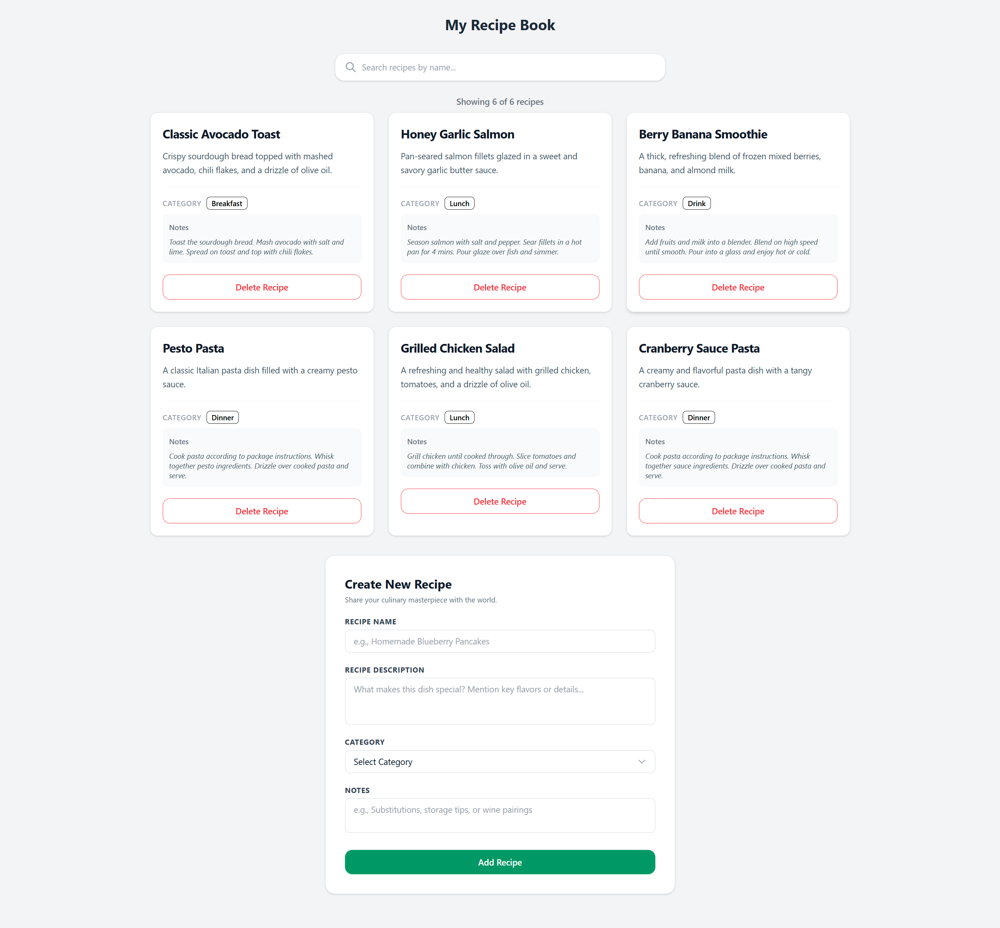

# React + Vite

This template provides a minimal setup to get React working in Vite with HMR and some Oxlint rules.

Currently, two official plugins are available:

- [@vitejs/plugin-react](https://github.com/vitejs/vite-plugin-react/blob/main/packages/plugin-react) uses [Oxc](https://oxc.rs)
- [@vitejs/plugin-react-swc](https://github.com/vitejs/vite-plugin-react/blob/main/packages/plugin-react-swc) uses [SWC](https://swc.rs/)

# 🍳 Recipe Box

A simple React app for keeping track of your favorite recipes — add new ones, search by name, and remove ones you no longer want. Built as a practice project while learning React.

## Screenshot



## Features

- 📖 Browse recipes in a responsive card grid
- ➕ Add a new recipe with name, description, category, and notes
- 🔍 Search recipes by name in real time
- 🗑️ Delete a recipe
- 🔢 Recipe count ("Showing X of Y recipes")
- ⚠️ Form validation with helpful error messages for missing fields
- 📱 Fully responsive layout (mobile, tablet, desktop)

## Tech Stack

- [React](https://react.dev/) — UI library
- [Vite](https://vite.dev/) — build tool / dev server
- [Tailwind CSS](https://tailwindcss.com/) — styling

## Getting Started

### Prerequisites

- [Node.js](https://nodejs.org/) (v18 or higher recommended)
- npm (comes with Node.js)

### Installation

1. Clone the repository

   ```bash
   git clone https://github.com/alaa-a-mo/react-recipe-box.git
   cd react-recipe-box
   ```

2. Install dependencies

   ```bash
   npm install
   ```

3. Start the development server

   ```bash
   npm run dev
   ```

4. Open the app in your browser at the URL shown in the terminal (usually `http://localhost:5173`)

## Project Structure

```
recipe-box/
├── src/
│   ├── assets/
│   │   └── recipe-box-project-screenshot.png
│   ├── components/
│   │   ├── AddRecipe.jsx      # Form for adding a new recipe
│   │   ├── Header.jsx         # The main header
│   │   ├── RecipeCard.jsx     # Single recipe card
│   │   ├── RecipeList.jsx     # Grid of recipe cards
│   │   └── SearchRecipes.jsx  # Search input
│   ├── App.jsx                # Main app logic and state
│   ├── index.css
│   └── main.jsx                # App entry point
├── index.html
├── vite.config.js
└── README.md
```

## How It Works

All recipe data lives in the `App` component's state and is passed down to child components as props:

- `RecipeList` / `RecipeCard` — display the recipes
- `SearchRecipes` — filters recipes by name as you type
- `AddRecipe` — a controlled form that validates required fields before adding a new recipe to the list

## Possible Future Improvements

- [ ] Filter recipes by category
- [ ] Edit an existing recipe
- [ ] Persist recipes to local storage so they survive a page refresh

## License

This project is open source and available for learning purposes.
